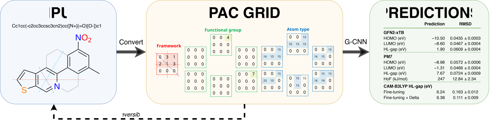

# PAC G-CNN

PAC G-CNN predicts the HOMO and LUMO energies, the HOMO-LUMO gap (HL-gap), and the heat of formation of polycyclic aromatic compounds (PACs) from the PAC grid, a reversible 13-channel hexagonal grid representation of the molecule. Because the network is equivariant under D<sub>6</sub>, the group of the 12 rotations and reflections of a regular hexagon, the predicted properties are invariant to the orientation of the PAC grid.

<picture>
  <source media="(prefers-color-scheme: dark)" srcset="docs/static/banner_dark.svg">
  
</picture>

This repository contains the code and dataset for the manuscript *Advanced Machine Learning for Prediction of HOMO-LUMO Gaps and Heats of Formation* (under review) by Tri M. Nguyen and Thanh N. Truong.

## The PAC grid

Each ring of the molecule is assigned to 1 tile of a 15 × 15 hexagonal lattice, and fused rings are assigned to neighbouring tiles. The 13 channels of the PAC grid encode the framework of each tile, the functional group at each of the 6 vertices of the hexagon of the tile, and the atom type at each vertex. The representation is described in [`docs/representation.md`](docs/representation.md). The terminology is defined in [`docs/glossary.md`](docs/glossary.md).

## Repository contents

| Path | Contents |
|---|---|
| `pac/` | The PAC grid: conversion between SMILES strings, molecular graphs, and PAC grids, the lattice geometry, and the D<sub>6</sub> transformations |
| `gcnn/` | The PAC G-CNN: the D<sub>6</sub>-equivariant lifting layer, the group convolutions, and the transformation tables |
| `dataset/` | The PyTorch datasets for PAC grids, fingerprints, and SMILES strings, the partitioning module, and the partitions of the cross-validation |
| `benchmarks/` | The CNN, BiLSTM, and MLP baselines, the Lightning module for training and evaluation, and the target scaler |
| `notebooks/` | The notebooks that train and evaluate the models of the manuscript |
| `predict_properties.py` | The prediction interface for the command line and for Python |
| `pac5_filtering.py` | Stages 2 and 3 of the PAC5 filter cascade (Supplementary Table 2) |
| `initial_geometry_openff_parralel.py` | The conformer search for the PAC5 molecules |
| `prep_3d_geometry_cache.py` | The geometry cache of the 3D baselines on PAC5-4 |
| `[manuscript_figure_3] conformer_comparison.py` | Fig. 3 |
| `const.py`, `utils.py` | Constants, such as the size of the PAC grid, and functions shared by the packages and the notebooks |
| `data/` | The PAC5 dataset and the PubChemQC and COMPAS-1D data (see [Data](#data)) |
| `docs/` | The Sphinx documentation (see [Documentation](#documentation)) |

## Installation

<!-- installation-start -->

The project requires Python 3.14 or later. This project use [uv](https://docs.astral.sh/uv/), but other package managers will also work.
It is likely that other versions of Python will work. Please manage the dependencies yourself.

```console
git clone https://github.com/Kamitri/pac-gcnn
cd pac-gcnn
uv sync
```

`uv sync` installs the dependencies of `pac`, `gcnn`, `dataset`, `predict_properties.py`, and the PAC G-CNN notebooks, with PyTorch from the CUDA 13.2 wheel index in `pyproject.toml`. The Chemprop notebooks also need the `all` extra:

```console
uv sync --extra all
```

## Predicting properties

`predict_properties.py` predicts 1 property for 1 or more molecules. For convenience, the input accepts SMILES. The script loads the checkpoints from `models/` (see [Checkpoints and logs](#checkpoints-and-logs)) and the statistics of the target standardization from `dataset/PAC5-1/`.

```console
$ uv run python predict_properties.py "c1ccc2ccccc2c1"
Predicting CAM-B3LYP HL-gap (eV) using FINETUNE. Weights loaded from fold 1
 + c1ccc2ccccc2c1: 7.2335

$ uv run python predict_properties.py "c1ccc2cc3ccccc3cc2c1" --theory pm7 --property homo
Predicting PM7 HOMO (eV). Weights loaded from fold 1
 + c1ccc2cc3ccccc3cc2c1: -8.3942
```

The options are case-insensitive and accept common alternative forms, such as `xtb`, `hl_gap`, and `hof`:

- `--theory`: `CAM-B3LYP` (default), `PM7`, or `GFN2-xTB`
- `--property`: `HOMO`, `LUMO`, `HL-gap` (default), or `heat-of-formation`
- `--high-fidelity-method`: `DIRECT`, `DELTA`, `FINETUNE` (default), `TRANSFER`, `FINETUNE-DELTA`, or `TRANSFER-DELTA`, for `CAM-B3LYP` only
- `--high-fidelity-fold`: the cross-validation fold of the high-fidelity model, from 1 to 5 (default 1)
- `--batch-size`: the number of molecules in each forward pass (default 256)
- `--device`: `cuda` or `cpu` (default `cuda` when a GPU is available)

At the GFN2-xTB and PM7 level, the models predict the HOMO, the LUMO, and the HL-gap. Heat of formation is also available at the PM7 level. The high-fidelity models, selected with `--theory CAM-B3LYP`, predict the HL-gap at the CAM-B3LYP level and the heat of formation at the level of the NIST reference values.

The 3 delta methods add a correction to a PM7 value. On the command line, the PM7 value is estimated by the PAC G-CNN at the PM7 level (although this is not recommended because the delta methods were designed with true low-level labels, use a non-delta-learning method instead if you do not have PM7 data). The Python function `predict_properties` accepts calculated PM7 values in `low_level_values`.

The Python function accepts a SMILES string, a `pac.PAC` object, a grid tensor, or a sequence of these inputs:

```python
>>> from predict_properties import predict_properties
>>> predict_properties(["c1ccccc1", "c1ccc2ccccc2c1"], theory="PM7", property_name="heat-of-formation")
array([102.79141229, 176.7710925 ])
```

## Data

The PAC5 dataset and the external data of the Supplementary Information are in `data/`:

- `data/pac5.xlsx`: The 679,291 PACs of PAC5, with the PubChem CID, the SMILES string, the category, the GFN2-xTB and PM7 properties, the CAM-B3LYP properties of the high-fidelity subset, and the NIST heats of formation
- `data/pubchemqc.db`: The original labels of the PubChemQC B3LYP/6-31G\*//PM6 dataset (`pubchemqc_*`) of the structures with a PubChemQC record and the modified labels of Supplementary Note 7 (`b3lyppm6_*`) of 11,198 of these structures
- `data/extras/compas1_modified_subset.csv`: The 7,607 molecules of COMPAS-1D, out of 8,678, representable by the PAC grid (Supplementary Note 8)

The `dataset` package creates the SQLite database `data/pac5.db` from `data/pac5.xlsx` when a PAC5 dataset class or the partitioning module first connects to the database. The conversion of the SMILES strings into PAC grids runs in the main process by default. The process takes a long time on a single CPU core so we recommend enabling multiprocessing via increasing `DEFAULT_NUM_WORKERS` in `const.py`. This constant also dictates many multiprocessing operations elsewhere.

The partitions of the cross-validation are in `dataset/`:

- `dataset/PAC5-1`, `dataset/PAC5-2`, and `dataset/PAC5-3`: The training, validation, and test sets of the 5 folds (`fold_{N}_train.csv`, `fold_{N}_val.csv`, and `fold_{N}_test.csv`), created by `dataset/split.py`, and prediction files (`fold_{N}_train_predictions.csv` and `fold_{N}_test_predictions.csv`)
- `dataset/PAC5-4`: The 5 folds of PAC5-4, created by `dataset/split.py`, and the geometry cache of the 3D baselines (`geom_openff.npz` and `geom_openff_index.csv`), built by `prep_3d_geometry_cache.py`
- `dataset/PAC5-1-no_high_fidelity`, `dataset/PAC5-1-no_high_fidelity_hl_gap`, and `dataset/PAC5-1-no_high_fidelity_hof`: A training set, a validation set, and a test set in each folder, without the high-fidelity molecules, for the pretraining of the models of Table 2, created by `dataset/split.py`

## Checkpoints and logs

The folder names in `models/` and `logs/` have the form `{model}_{parameter count}-{representation}-[{dataset}]-fold_{N}`, for example `gcnn_1.1M-pac_grid-[PAC5-3]-fold_1`. Each folder in `models/` has the weights of the epoch with the lowest validation loss in `best.ckpt`, except the folders of the multifidelity models of Table 2. These models have 1 folder for each method, such as `gcnn_3.7M-pac_grid-[PAC5-hl_gap-to_camb3lyp_hl_gap]-finetune_delta`, with the files `fold_1.pth` to `fold_5.pth`. The training notebooks write new checkpoints and logs to the same folders.

The logs are TensorBoard event files:

```console
uv run tensorboard --logdir logs
```

Model checkpoints are in `models/`. Logs are in `logs/`.

<!-- installation-end -->

## Reproducing the results

The table lists the code of each result in the manuscript and in the Supplementary Information. The notebooks are in `notebooks/`.

| Result | Code |
|---|---|
| Table 1 | `pac5_pac_matrix.ipynb` (PAC G-CNN), `pac5_pac_matrix_cnn.ipynb` (CNN), `pac5_chemprop.ipynb` (Chemprop), `pac5_lstm.ipynb` (BiLSTM), and `pac5_fingerprint.ipynb` (MLP) |
| Table 2 | `pac5_multilevel_bg_*.ipynb` (HL-gap, CAM-B3LYP) and `pac5_multilevel_hof_*.ipynb` (heat of formation, NIST), 1 notebook for each method |
| Fig. 3 | `[manuscript_figure_3] conformer_comparison.py` |
| Fig. 4 | `pac5_pac_matrix.ipynb` |
| Extended Data Fig. 2 | `[SI_extended_data_figure_2] hl_gap_correlation.ipynb` |
| Extended Data Table 2 | `pac5_pac_matrix.ipynb`, with the depth and the width of each model |
| Extended Data Table 3 | `pac5_4_pac_matrix.ipynb`, `pac5_4_chemprop_1M.ipynb`, `pac5_4_chemprop_default.ipynb`, `pac5_4_schnet_1M.ipynb`, `pac5_4_schnet_default.ipynb`, `pac5_4_unimol_1M.ipynb`, and `pac5_4_unimol_pretrained_default.ipynb` |
| Extended Data Table 4 | Cell 4 of `pac5_4_pac_matrix.ipynb` (PAC G-CNN rows) |
| Supplementary Table 2 | `pac5_filtering.py` |
| Supplementary Note 3 | `[SI_note_3] equivariance.ipynb` |
| Supplementary Note 7 | `pubchemqc_pac_grid_cnn.ipynb` and `pubchemqc_pac_grid_gcnn.ipynb` |
| Supplementary Note 8 | `compas1_pac_matrix_gcnn.ipynb` and `compas1d_se3_transformer.ipynb` |

## Documentation

Sphinx documentation is located in `docs/`: the installation guide, the PAC grid representation, the glossary, and API reference.

## Citation

The reference of the manuscript will be added after publication:

## License

The code in this repository is available under the MIT License (see [`LICENSE`](LICENSE)). The data from other sources are available under their terms:

- `data/pubchemqc.db` contains a subset of the PubChemQC B3LYP/6-31G\*//PM6 dataset (Nakata, M. & Maeda, T. *J. Chem. Inf. Model.* **63**, 5734–5754 (2023)), Copyright © 2019, 2020, 2021, 2022, 2023 NAKATA Maho, MAEDA Toshiyuki, SHIMAZAKI Tomomi, HASHIMOTO Masatomo, under the [Creative Commons Attribution 4.0 International License](https://creativecommons.org/licenses/by/4.0/).
- `data/extras/compas1_modified_subset.csv` contains a subset of COMPAS-1D from the COMPAS Project (Wahab, A., Pfuderer, L., Paenurk, E. & Gershoni-Poranne, R. *J. Chem. Inf. Model.* **62**, 3704–3713 (2022)), under the [Creative Commons Attribution 4.0 International License](https://creativecommons.org/licenses/by/4.0/).
- The `nist_hof` column of `data/pac5.xlsx` contains the heats of formation of NIST Special Publication 1186 (Allison, T. C. & Burgess Jr., D. R. *Thermodynamic Properties of Polycyclic Aromatic Hydrocarbons* (2015), [doi:10.6028/NIST.SP.1186](https://doi.org/10.6028/NIST.SP.1186)).
- The PubChem CIDs and the SMILES strings of PubChem compounds are from [PubChem](https://pubchem.ncbi.nlm.nih.gov/).
